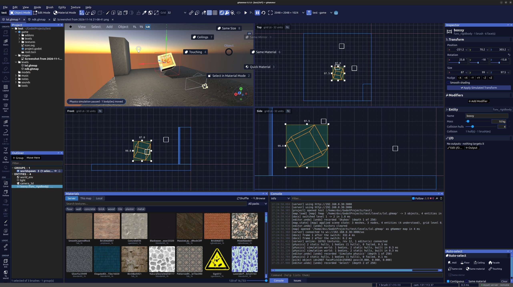
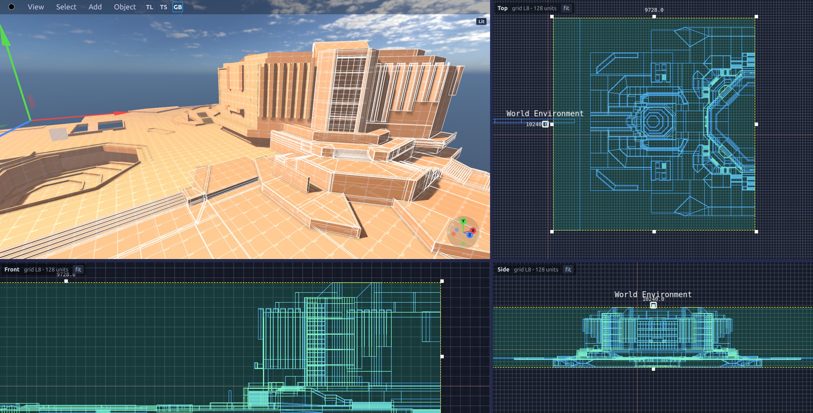
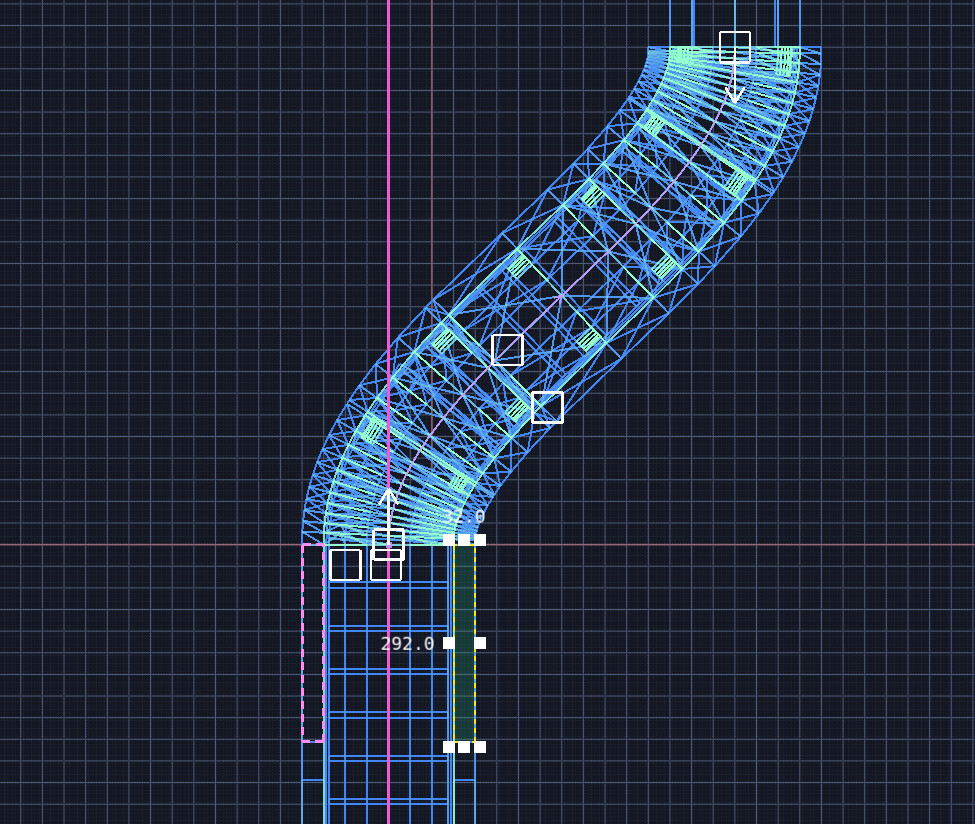
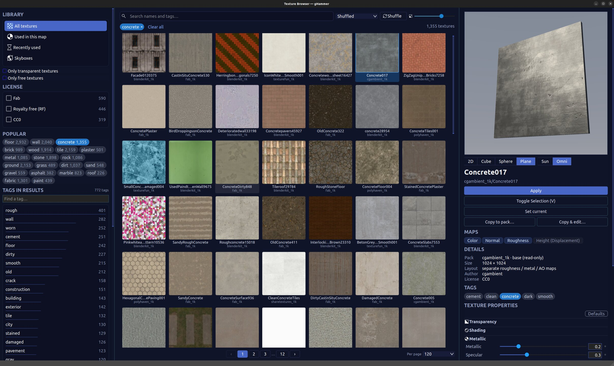
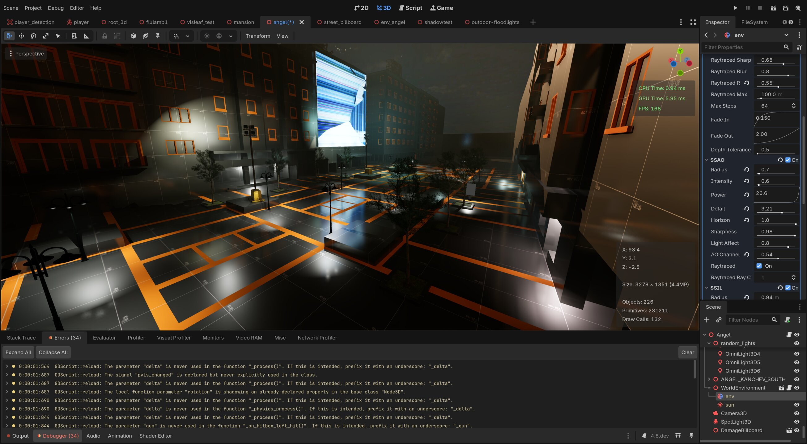

# gHammer

The open-source, cross-platform Qt6 level editor for Godot 4.8+.

Works with vanilla Godot - no addons required.



## Features

- Blender-like interface with Hammer-like keybinds
- Source Engine units instead of meters
- 3D Vulkan viewport matches Godot's 3D Vulkan renderer
- (optional) client/server architecture (remote assets server)
- Project management similar to Jetbrains IntelliJ (`~/GodotProjects/`)
- Texture browser stays fast with (tens of) thousands PBR textures
- Advanced features
  - Smart face selection in material mode 
  - Mirror functionality for brushes
  - Modifiers (array, curve)
  - Source-like I/O system that outputs to gdscript
  - physics engine
  - Open multiple levels
  - Integration with external applications
  - Layout designer - quickly make corridors, and rooms
- Launch Godot from the level editor

#### NDK



## When to use gHammer

1. You want to quickly prototype, and iterate on 3D environments.
2. You know what a brush-based level editor is, the limitations, and are not satisfied with the workflow of trenchbroom, radiant, GodotVMF, etc.
3. You want an open-source level editor that works well on Linux.
4. You understand the paradigm behind Source-like I/O systems, and its benefits/drawbacks compared to gdscript or UE blueprints.
5. You understand the benefits of client/server architecture, and how that could be useful in a team of developers.
6. You understand the benefit of IntelliJ-style project management.
7. You like C++/Qt applications that compile easily, and use QtWidgets for accessibility.
8. You understand that this level editor was made to satisfy our requirements, which may differ from yours.
9. You understand this level editor is still in alpha, and some features are missing.

## When not to use gHammer

1. You expect support questions answered, frequent updates, or bugfixes.
    - [Valve time](https://developer.valvesoftware.com/wiki/Valve_Time)
2. You use Windows / Mac OS. 
    - While a build for Windows *is* provided, it is not our focus (unofficial build).
3. You prefer an embedded level editor within Godot itself (those exist).
4. You want 'organic looking' levels, in that case consider an actual modelling program.
5. You do not like software created with AI assistance.

#### Mirrored corridor along an S-bend with height elevation



## Compile

Install system-wide, and register a XDG desktop entry. Ubuntu example: 

```bash
sudo apt install -y libpng pkg-config cmake qt6-base-dev qt6-websockets-dev unzip build-essential

git clone https://github.com/kroketio/ghammer.git
cmake -Bbuild .
make -Cbuild -j8
sudo make -Cbuild -j8
```

If you have a custom path to Qt, use `-DCMAKE_PREFIX_PATH=/path/to/qt/6.9.3/gcc_64`

Static binaries from releases are produced by [ghammer-build-containers](https://github.com/kroketio/ghammer-build-containers).

For distro maintainers; CMake's fetch_content is not used, and use `-DUSE_VENDORED_LIBS=OFF` 

## Workflow

The workflow is the following:

1. Open ghammer, create a new project, this creates:
    1. `~/GodotProjects/<project>/` 
    2. `~/GodotProjects/<project>/levels/`
    3. `~/GodotProjects/<project>/game/` - Godot Forward+ project (automatically generated)
    4. Already have an existing project? replace the `game` folder. ghammer will not modify/destroy it. ghammer only exports to specific paths within your godot project.
2. Upon `.ghmap` save, the Godot project is automatically updated. Specifically, the `.tscn` file of that level will be created or updated, as well as associated `.gltf` of that level (geometry), and materials are exported.
    1. e.g. `game/textures/blenderkit_1k/Box128428_1K_ARM.png`, `box128428.tres`, etc.
3. Godot notices that files were updated, so it reloads scene(s), and resources.
4. To display levels, you have your own `.tscn`, where you instance `levels/<name>/<name>.tscn` in your scene.

Note: skyboxes, and LUT(s) are exported as resources, and it is your job to create a world environment, 
and assign these resources. This is because ghammer does not manage your world environment.

Note #2: gHammer ships without skyboxes, or materials. Those come from asset packs, installable from within the editor.

## Tips

1. Use `1`, `2`, `3` to switch between object, edit, and material mode.
2. Use `Shift+S` to bring up the pie menu.
3. Consider watching a basic tutorial on Hammer (Source 1 Engine).
4. The default texture, measurewall, will be culled upon Godot export. This is because the world geometry eliminates faces to reduce vertices count. To disable that, go to `File->Level Settings` and check `export dev materials`.
5. (optimized) world collisions are automatically generated, and exported.
6. When using the same material for 2 separate rooms, and one material needs to be 'less shiny' in the other room (change e.g. roughness), use the texture variant feature.
7. When using the same material for 2 separate rooms, and one material needs to be a slightly different color (change albedo), use 'copy texture into new pack'. This creates a new copy. From there, you can edit the albedo (right-click, open in external image authoring tool).
8. use `g` to show/hide generated brushes (brushes subject to modifiers).
9. When moving brushes, consider enabling texture lock to keep texture alignment.

#### Texture browser



## Server (optional)

By default, the server is started automatically (in local mode).

This section is for running the gHammer server somewhere 
remotely (e.g. on your LAN). It provides a HTTP JSON API, as well 
as websockets.

Starting requires no arguments, just `./ghammer_server`. Then connect to it from within the level editor.

See `--help` for more options (e.g. credentials).

It will use `~/.config/ghammer/` as data path.

#### systemd unit

[ghammer.service](tools/ghammer.service) - `/etc/systemd/system/ghammer.service` 

`sudo systemctl daemon-reload && sudo systemctl restart ghammer`

# To-do's

- Material creation
  1. built-in image editor
  2. automate specular/normal generation
- 3D models (props)
  1. server support for 3d models
  2. client support for importing models, adjusting them for scale, etc.
  3. randomly placing them via the physics engine
- Displacements / terrain
- Vertex painting
- Material hotspots
- Decals
- Animation timeline
- Improve I/O system (untested currently)

#### A gHammer street in Godot



## Contributing

Large, AI generated merge requests are annoying to review, however if the 
addition follow existing UI/UX paradigms, is stable/robust, and is useful, we will merge it.

# License

0BSD

Some parts of the code (e.g. vendored libraries), are subject to a different license.